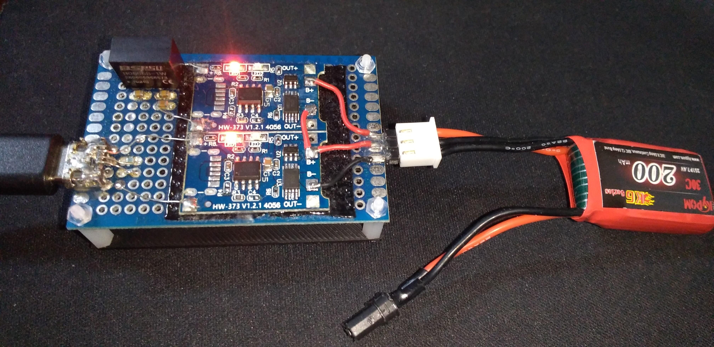
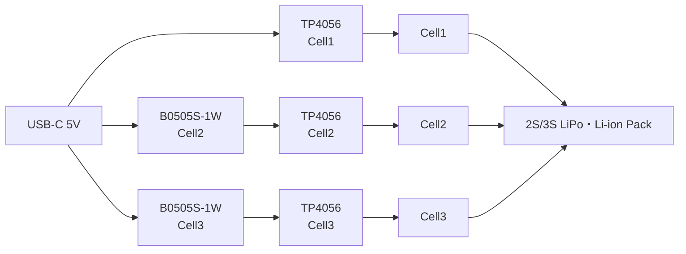

# TP4056 Multicell Charger

A USB Type-C powered charger for small 2S/3S LiPo and Li-ion battery packs.

This project was designed to provide a simple and convenient way to charge small multicell batteries without using a full-featured RC balance charger.

## Prototype

## Features

- USB Type-C input
- Supports 2S and 3S LiPo / Li-ion battery packs
- Independent CC/CV charging for each cell
- Approximately 120mA charging current per cell
- TP4056-based charging channels
- Isolated DC/DC converters for upper cells
- No conventional balancing circuit required

## Recommended Battery Capacity

100mAh - 300mAh

The charging current is approximately 120mA per cell. This corresponds to about 1C charging for a 120mAh battery and about 0.4C for a 300mAh battery.

## Charging Current

Each charging channel is configured for approximately 120mA using a 10kΩ PROG resistor.

## Concept

Conventional multicell chargers charge the entire battery pack while balancing cell voltages using a balancing circuit.

This project takes a different approach. Each cell is charged independently using its own TP4056 charger.

Because the cells inside a 2S/3S pack are connected in series, each TP4056 charger must operate in an isolated power domain. Isolated DC/DC converters allow multiple TP4056 channels to charge different cells independently.

As a result, cell voltages naturally converge without requiring a conventional balancing circuit.

## BOM
[PartsCabi.net](https://partscabi.net/list/6ee6419b-a65a-492d-b7c7-b3cb2271a9e4)

## Limitations

- This charger assumes that all cells are in reasonable condition and have similar characteristics.
- Cell voltage balance may vary depending on differences in cell aging, internal resistance, capacity, and self-discharge rate.
- Perfect cell balancing under all conditions is not guaranteed.
- This project is intended for users who understand the operating principles and limitations of Li-ion/LiPo charging circuits.
- Users are expected to review the schematic and evaluate the design themselves before use.

## Safety Notice

- For LiPo and Li-ion batteries only.
- Do not use damaged batteries.
- Never leave batteries unattended while charging.
- Do not connect batteries to both the 2-cell and 3-cell connectors simultaneously.
- Verify connector polarity before use.
- Use this project at your own risk.

## Disclaimer

This project is provided for educational, experimental, and research purposes only.

Lithium battery charging involves inherent risks. The author assumes no responsibility for any damage, injury, or loss resulting from the use of this project.

## License

MIT License
